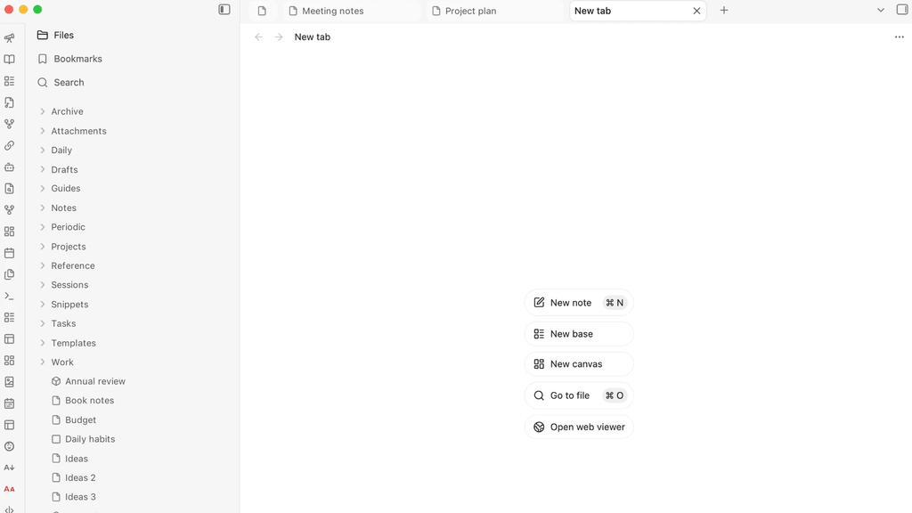

# Contemporary



An Obsidian theme, built up one change at a
time. See the header of `theme.css` for what's in so far.

## Companion plugin

The left sidebar's Files row gets a hover "..." menu (new note, new folder, sort order,
expand/collapse...) from the **Contemporary Theme Settings** plugin. The theme works
without it; the explorer just keeps its normal button row.

## Developing

This folder lives at `.obsidian/themes/Contemporary` inside the vault you edit it from,
so Obsidian picks it up automatically:

1. Settings → Appearance → Themes → select **Contemporary**.
2. Uncheck Settings → Appearance → **Show ribbon** for the full effect.
3. Edit `theme.css`, save, and reload Obsidian ("Reload app without saving" in the
   command palette) to see changes.
4. Check both light and dark under Settings → Appearance → Base color scheme.

Reference for available variables: https://docs.obsidian.md/Reference/CSS+variables

## Releasing

The community directory installs from GitHub releases, so each version needs one:

1. Bump `version` in `manifest.json` (x.y.z) and commit.
2. Create a release whose tag matches that version, with `manifest.json` and `theme.css`
   attached:

   ```bash
   gh release create X.Y.Z manifest.json theme.css --title "X.Y.Z" --notes "What changed"
   ```

## Submitting to the Obsidian community directory

1. Sign in at [community.obsidian.md](https://community.obsidian.md) and link your GitHub
   account.
2. Add the theme. The repo needs `README.md`, `LICENSE`, `manifest.json`, `theme.css` and a
   screenshot (`screenshot.png`, 512 x 288 recommended) in place, plus the release above.

Full guidelines: https://docs.obsidian.md/Themes/App+themes/Submit+your+theme
